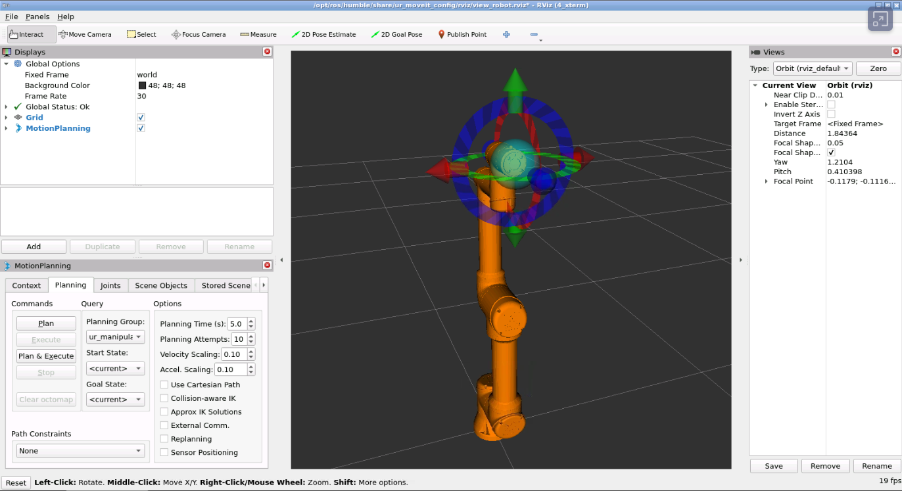
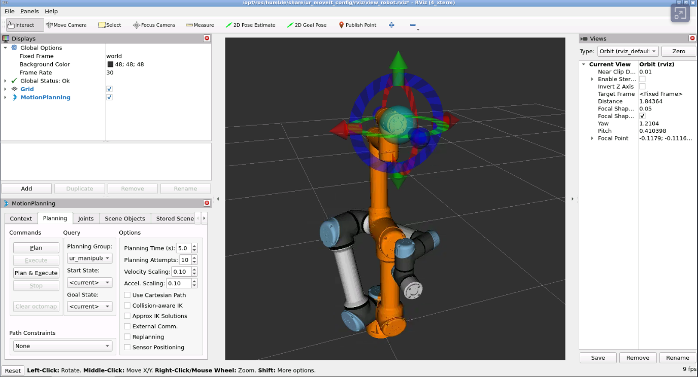

# Social Robotics with the UR5e:

# Guided practical activity: previous simulation before real development

### Session 2 - Ubuntu 22.04, VS Code and ROS 2 Humble

### Goal and requirements

Before Session 2, simulate the same `handshake, give5 and custom_motion` movement locally with ROS 2, the fake UR5e driver, MoveIt 2, and RViz. All five ROS 2 processes run on the same Ubuntu computer.

### 1. Create a new ROSject on theConstruct environment

You need Ubuntu 22.04 and **ROS 2 Humble**. Work in TheConstruct environment for this activity. Each time you enter its environment, run:

```bash
sudo apt update
sudo apt install ros-humble-ur
```

### 2. Clone and open the project

In a terminal, run:

```bash
cd /home/user
git clone https://github.com/GITHUB_USERNAME/UR5e_social_robotics.git
cd /home/user/UR5e_social_robotics
```

### 2. Review `~/.bashrc`

Open it with `code ~/.bashrc` and add these lines at the end. Do not add duplicates if they already exist:

```bash
# ROS 2 Humble and this local workspace
source /opt/ros/humble/setup.bash
source /home/user/UR5e_social_robotics/install/setup.bash
cd /home/user/UR5e_social_robotics
# Local, one-computer simulation
export ROS_DOMAIN_ID=0
export ROS_LOCALHOST_ONLY=0
export RMW_IMPLEMENTATION=rmw_cyclonedds_cpp
```

For this local activity, `ROS_LOCALHOST_ONLY=0` enables ROS 2 communication on this computer and others in the network.

### 3. Build the workspace

In the VS Code integrated terminal:

```bash
cd /home/user/UR5e_social_robotics
colcon build
```


## 4. Define your social movement

Copy `handshake.yaml` from [the example motions](../src/social_robot_behaviors/motions/)
to `src/social_robot_behaviors/motions/<motion_name>.yaml`. Use a lowercase name
without spaces. ROS 2 looks up the filename using the requested motion name,
without the `.yaml` extension.

A motion file has a `common` settings block and an ordered `steps` list. This
single-step example uses the opening pose from `handshake.yaml`.

```yaml
common:
  execute: true
  group_name: ur_manipulator
  ik_link: tool0
  target_frame: table
  planning_frame: base_link
  max_velocity: 0.1
  max_acceleration: 0.1
  ik_timeout_sec: 1.0
  print_joints: true

steps:
  - name: home_start
    target_xyz: [0, -400, 500]
    target_rpy: [90.0, 0.0, 0.0]
    seed_from_joint_states: false
    seed_joints: [-60, -60, -100, 170, -60, 0]
    duration: 4.0
    sleep_after: 1.0
```

- `target_xyz` is the position in millimetres in `target_frame`, normally `table`.
- `target_rpy` is roll, pitch and yaw in degrees.
- `duration` is the movement time in seconds. Optional `sleep_after` is the pause in seconds.
- `seed_from_joint_states: true` uses the current joint state as the starting point for inverse kinematics. When supplying `seed_joints`, give six joint angles in degrees.

Add the intermediate and final poses under `steps`. Keep the start and end
configurations safe and verify each step in simulation. 

### 4. Verify the examples and your social movement

Open **five VS Code terminals**. Then start one process in each terminal.

**Terminal 1 - fake UR5e driver**

```bash
ros2 launch ur_robot_driver ur_control.launch.py \
  ur_type:=ur5e robot_ip:=192.168.0.20 \
  use_fake_hardware:=true launch_rviz:=false
```

**Terminal 2 - MoveIt 2 and RViz**

```bash
ros2 launch ur_moveit_config ur_moveit.launch.py \
  ur_type:=ur5e launch_rviz:=true
```

Wait until RViz displays the robot and MoveIt 2 is ready.



**Terminal 3 - sequence server**

```bash
ros2 run ur5e_motion_server ur5e_sequence_server
```

**Terminal 4 - behaviour manager client**

```bash
ros2 launch social_robot_behaviors social_behavior.launch.py
```

**Terminal 5 - example requests**

```bash
ros2 topic pub --once /social_behavior std_msgs/msg/String "{data: 'handshake'}"
ros2 topic pub --once /social_behavior std_msgs/msg/String "{data: 'give5'}"
```



Both supplied motions must run in RViz.

Finally, send your motion:

```bash
ros2 topic pub --once /social_behavior std_msgs/msg/String "{data: 'wave'}"
```

Replace `wave` with your own name.

**Insert the video of simulated motion here!**

### 6. Delivery

Update the Director's group GitHub repository with:

- `UR5e_social_robotics\src\social_robot_behaviors\motions\custom_motion.yaml`;
- Inserted video of simulated motion.
